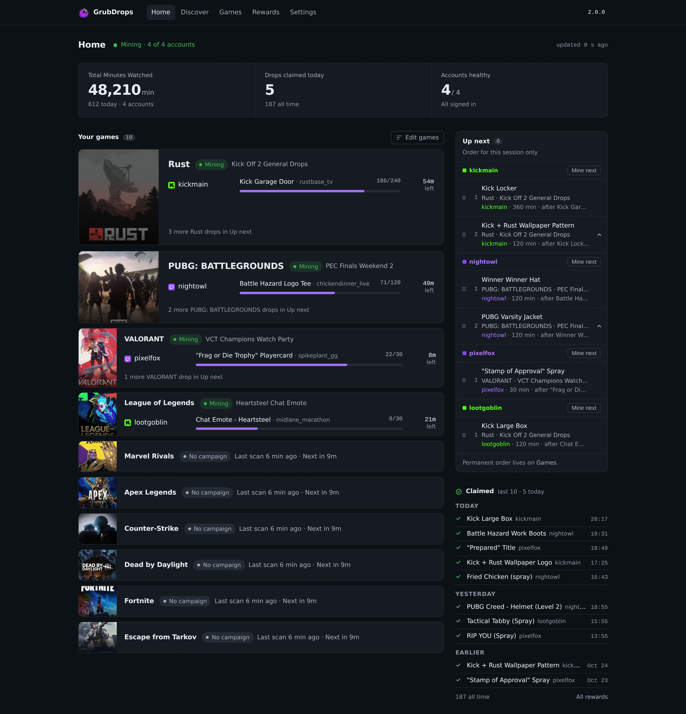
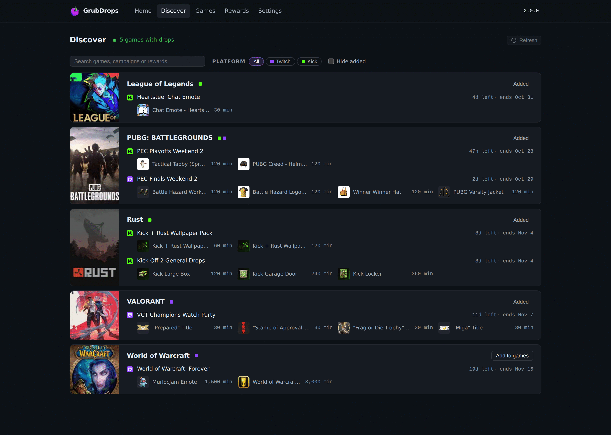
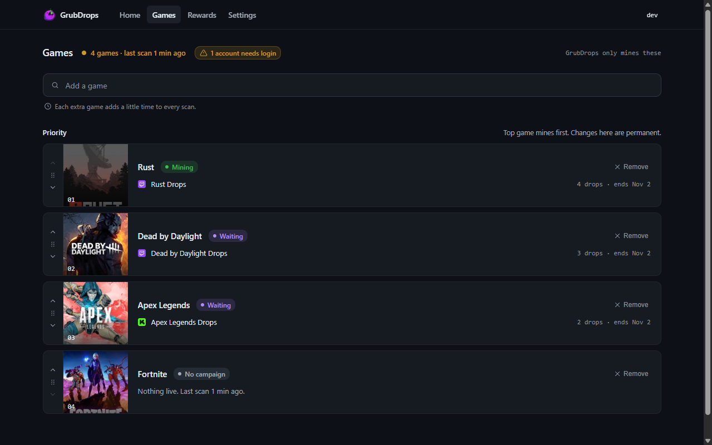
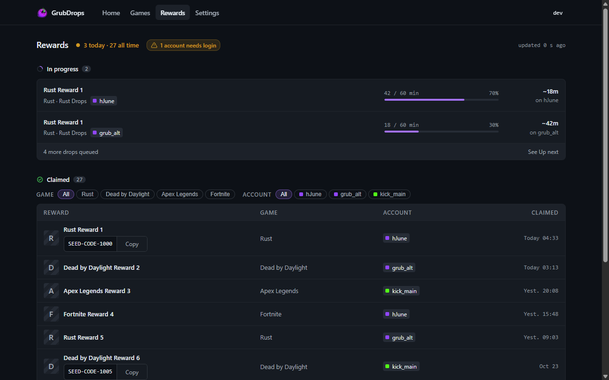

<p align="center">
  
</p>

<p align="center"><sub><a href="../../README.md">English</a> · <a href="README.zh-CN.md">简体中文</a> · <strong>Español</strong></sub></p>

<h3 align="center">Minero de drops de Twitch y Kick autoalojado.</h3>

<p align="center">
  <a href="https://github.com/aalejandrofer/GrubDrops/releases"></a>
  <a href="https://github.com/aalejandrofer/GrubDrops/pkgs/container/grubdrops"></a>
  
  
  
</p>

<p align="center">
  
</p>

GrubDrops mira streams de Twitch y Kick de los juegos que eliges, acumula el
tiempo de visualización y reclama los drops, en varias cuentas a la vez.
Funciona como un solo contenedor de Docker con interfaz web y guarda todo en un
único archivo SQLite.

## Funciones

- **Twitch y Kick, varias cuentas.** Cada cuenta mina en paralelo y todas aparecen en Inicio.
- **Descubrir.** Muestra todas las campañas actuales de ambas plataformas. Añade un juego a tu lista con un clic.
- **Tú decides la prioridad.** Ordena tus juegos en Juegos. Cada cuenta tiene su propia cola A continuación, que puedes reordenar, y un botón Minar siguiente.
- **Reclamo automático.** Los drops se reclaman al completarse. Si un drop exige vincular la cuenta del editor, vincúlala y pulsa Comprobar ahora.
- **Avisos e inicio de sesión.** Notificaciones por Discord y Telegram, inicio de sesión único OIDC opcional y un asistente de primer uso.

## Inicio rápido

```yaml
# compose.yml
services:
  miner:
    image: ghcr.io/aalejandrofer/grubdrops:latest
    restart: unless-stopped
    ports: ["8080:8080"]
    environment:
      GRUB_SECURE_COOKIES: "0"   # 1 behind HTTPS
      TZ: Europe/London
    volumes:
      - ./data:/data
      - /var/run/docker.sock:/var/run/docker.sock   # Kick only
```

```bash
mkdir -p data && sudo chown 65532:65532 data
docker compose up -d
```

Abre http://localhost:8080 y crea el usuario administrador. Después, un
asistente te guía para añadir una cuenta y elegir juegos.

- En el primer arranque el minero crea `data/master.key` y lo reutiliza después. Cifra las sesiones guardadas, así que guárdalo junto a `miner.db`. Para tener la clave fuera de `./data`, pon en `GRUB_MASTER_KEY` la salida de `docker run --rm ghcr.io/aalejandrofer/grubdrops:latest keygen`; tiene prioridad sobre el archivo.
- El contenedor se ejecuta con el UID 65532, así que ese usuario debe poder escribir en `./data`.
- `GRUB_SECURE_COOKIES` debe coincidir con cómo accedes a la interfaz: `0` para HTTP, `1` para HTTPS. Si no coincide, aparece "Invalid CSRF token".
- El socket de Docker solo hace falta para Kick. El minero lo usa para arrancar un sidecar de Chrome por cada cuenta de Kick. Quita el montaje si solo minas Twitch.

Hay imágenes para `amd64` y `arm64`. En arm64 cada sidecar de Kick necesita unos 4 GB de RAM.

## Añadir cuentas

Abre **Ajustes > Cuentas**, o usa el asistente de primer uso.

**Twitch, inicio de sesión Android (recomendado).** Inicia sesión en Twitch en la
pestaña que abre GrubDrops. Llegarás a una URL como `https://www.twitch.tv/#access_token=XXX&scope=&token_type=bearer`.
Copia la URL completa y pégala en GrubDrops. Descubrir necesita un inicio de sesión Android para listar campañas de Twitch.

**Twitch, código de TV.** Abre el enlace que aparece e introduce el código.

**Kick.** Exporta las cookies de kick.com en formato Netscape con
[Get cookies.txt LOCALLY](https://chromewebstore.google.com/detail/get-cookiestxt-locally/cclelndahbckbenkjhflpdbgdldlbecc)
(Chrome, Edge, Brave) o
[cookies.txt](https://addons.mozilla.org/en-US/firefox/addon/cookies-txt/)
(Firefox), y sube o pega el archivo. Cuando la sesión caduque, vuelve a exportarlo
y pegarlo.

## Configuración

Ninguna variable es obligatoria. Todas las variables están en
[`deploy/docker-compose.yml`](../../deploy/docker-compose.yml).

| Variable | Por defecto | Uso |
|-----|---------|---------|
| `GRUB_MASTER_KEY` | `master.key` junto a la base de datos | Clave age que cifra las sesiones guardadas; se genera en el primer arranque si no está definida |
| `GRUB_HTTP_ADDR` | `0.0.0.0:8080` | Dirección de escucha |
| `GRUB_DB_PATH` | `/data/miner.db` | Archivo SQLite |
| `GRUB_SECURE_COOKIES` | `0` | `1` si se sirve por HTTPS |
| `GRUB_LOG_LEVEL` | `info` | `debug`, `info`, `warn`, `error` |
| `GRUB_DISCORD_WEBHOOK` | ninguno | Webhook de Discord, si no hay uno guardado en Ajustes |
| `GRUB_TELEGRAM_BOT_TOKEN` | ninguno | Token del bot de Telegram, si no hay uno guardado en Ajustes |
| `GRUB_TELEGRAM_CHAT_ID` | ninguno | ID del chat de Telegram, si no hay uno guardado en Ajustes |
| `GRUB_UPDATE_CHECK` | activado | `0` desactiva la comprobación de versiones en GitHub |
| `GRUB_KICK_SIDECAR_IMAGE` | `ghcr.io/aalejandrofer/grubdrops-browser:latest` | Imagen del sidecar de Kick |
| `GRUB_KICK_SIDECAR_NETWORK` | detección automática | Red de Docker para los sidecars de Kick |

### Inicio de sesión único (OIDC)

SSO se activa cuando defines las cuatro primeras variables. El inicio de sesión
con contraseña sigue funcionando salvo que lo desactives (ver [Solo SSO](#solo-sso)).

| Variable | Obligatoria | Uso |
|-----|----------|---------|
| `GRUB_OIDC_ISSUER` | sí | URL del emisor |
| `GRUB_OIDC_CLIENT_ID` | sí | ID de cliente |
| `GRUB_OIDC_CLIENT_SECRET` | sí | Secreto de cliente |
| `GRUB_OIDC_REDIRECT_URL` | sí | `https://<host>/auth/oidc/callback` |
| `GRUB_OIDC_PROVIDER_NAME` | no | Texto del botón, por defecto `SSO` |
| `GRUB_OIDC_ALLOWED_EMAILS` | no | Lista de correos permitidos, separados por comas |
| `GRUB_OIDC_ALLOWED_GROUPS` | no | Grupos exigidos en el claim `groups` |

> [!WARNING]
> Sin lista de permitidos, cualquiera que tu proveedor de identidad autentique se convierte en administrador.

#### Solo SSO

La contraseña de administrador sigue funcionando junto a SSO. Para que SSO sea
la única forma de entrar, desactiva **Inicio de sesión con contraseña** en
Ajustes, Autenticación. El interruptor solo aparece con SSO configurado.
Ajustes, Autenticación, Configurar te guía en la configuración. El inicio de sesión con contraseña vuelve solo siempre que SSO no
esté configurado, también cuando el proveedor de identidad no responde al
arrancar.

Si SSO está configurado pero no puedes entrar con él, vuelve a activar la
contraseña desde el host de Docker. Sirve cualquiera de estas dos formas.

Borra la fila del ajuste en `miner.db` (clave `settings:password_login_disabled`):

```bash
docker compose stop miner
sudo sqlite3 data/miner.db "DELETE FROM kv WHERE key = 'settings:password_login_disabled';"
docker compose start miner
```

O arranca el miner con `GRUB_AUTH_BYPASS_LOCAL=1` y llama a la API de ajustes
desde el host. Usa el puerto publicado, no un proxy inverso: las peticiones con
`X-Forwarded-For` no pasan. La API pide la cookie CSRF y la cabecera
`X-CSRF-Token` correspondiente:

```bash
TOKEN=$(curl -s -c grub.cookies http://localhost:8080/api/session \
  | sed -n 's/.*"csrf_token":"\([^"]*\)".*/\1/p')
curl -s -b grub.cookies -X PUT http://localhost:8080/api/settings \
  -H "X-CSRF-Token: $TOKEN" -H "Content-Type: application/json" \
  -d '{"password_login_disabled":false}'
```

Después quita `GRUB_AUTH_BYPASS_LOCAL`.

## Cómo funciona

- **Twitch** va por HTTP directo, sin navegador: GraphQL para campañas y reclamos, y una señal de visualización cada minuto.
- **Kick** detecta y reclama drops por HTTP. El tiempo de visualización va primero por WebSocket y pasa al sidecar de Chrome si deja de acumular.
- **Cada cuenta** tiene un runner. Mina el drop de mayor prioridad en el que puede avanzar, lo reclama y pasa al siguiente.

## Capturas

<p align="center">
  
  
  
</p>

## Desarrollo

```bash
npm --prefix web ci && npm --prefix web run build   # SPA into internal/web/dist
web/scripts/dev-miner.sh                            # miner on a temp DB, prints GRUB_DEV_DIR
GRUB_DEV_DIR=<dir> web/scripts/dev-seed.sh          # admin, sample games and accounts
GRUB_DEV_API=http://127.0.0.1:18080 npm --prefix web run dev
```

## Créditos, licencia y uso

Se apoya en lo que [DevilXD/TwitchDropsMiner](https://github.com/DevilXD/TwitchDropsMiner) y [HyperBeats/KickDropsMiner](https://github.com/HyperBeats/KickDropsMiner) descubrieron sobre los drops de Twitch y Kick.
Publicado bajo la [licencia MIT](../../LICENSE). Úsalo en tus propias cuentas, dentro de las condiciones de cada plataforma y bajo tu responsabilidad.

<sub>Consulta el <a href="../CHANGELOG.md">registro de cambios</a> y las <a href="../DESIGN.md">notas de diseño</a>.</sub>
