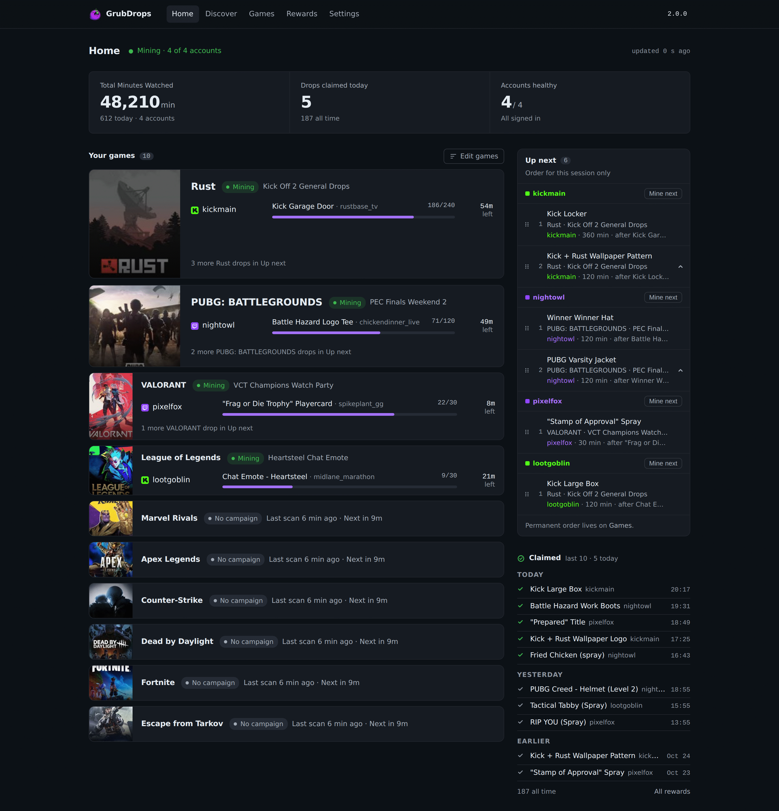
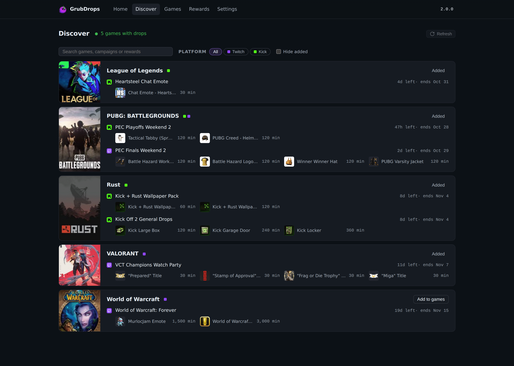
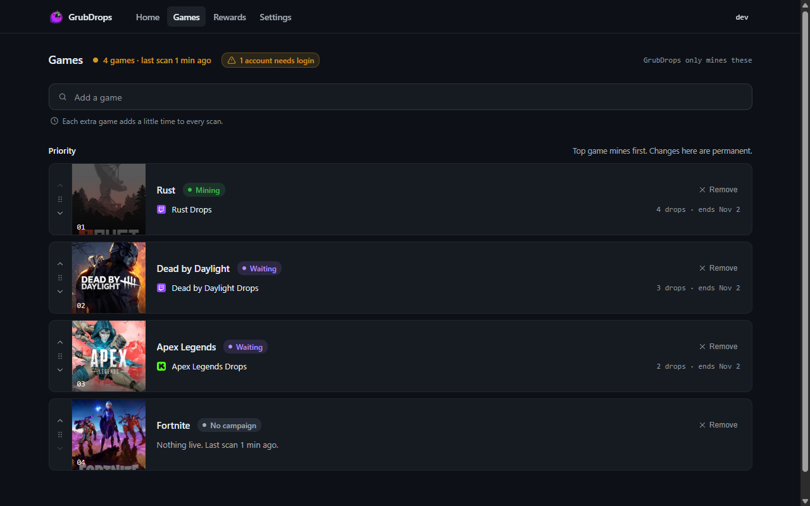
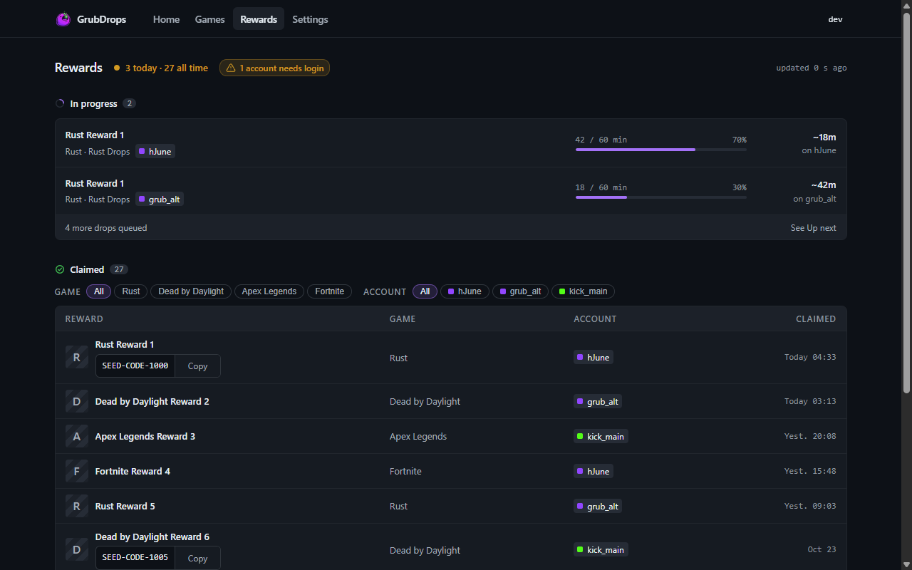

<p align="center">
  
</p>

<p align="center"><sub><a href="../../README.md">English</a> · <strong>简体中文</strong> · <a href="README.es.md">Español</a></sub></p>

<h3 align="center">自托管的 Twitch 和 Kick 掉宝挖矿工具。</h3>

<p align="center">
  <a href="https://github.com/aalejandrofer/GrubDrops/releases"></a>
  <a href="https://github.com/aalejandrofer/GrubDrops/pkgs/container/grubdrops"></a>
  
  
  
</p>

<p align="center">
  
</p>

GrubDrops 会为你选择的游戏观看 Twitch 和 Kick 直播，累积观看时长并领取掉宝，
可同时用于多个账号。它以单个 Docker 容器运行，带网页界面，所有数据保存在一个
SQLite 文件中。

## 功能

- **Twitch 和 Kick，多账号。** 每个账号并行挖矿，全部显示在首页上。
- **发现。** 列出两个平台当前的所有活动。一键把游戏加入列表。
- **优先级由你决定。** 在游戏页排序。每个账号都有自己的接下来队列，可以重新排序，还有"挖取下一个"按钮。
- **自动领取。** 掉宝完成后自动领取。如果需要绑定发行商账号，绑定后点击"立即检查"。
- **通知与登录。** Discord 和 Telegram 通知、可选的 OIDC 单点登录，以及首次运行向导。

## 快速开始

```yaml
# compose.yml
services:
  miner:
    image: ghcr.io/aalejandrofer/grubdrops:latest
    restart: unless-stopped
    ports: ["8080:8080"]
    environment:
      GRUB_SECURE_COOKIES: "0"   # 1 behind HTTPS
      TZ: Europe/London
    volumes:
      - ./data:/data
      - /var/run/docker.sock:/var/run/docker.sock   # Kick only
```

```bash
mkdir -p data && sudo chown 65532:65532 data
docker compose up -d
```

打开 http://localhost:8080 并创建管理员账号。随后向导会引导你添加账号并选择游戏。

- 首次启动时，挖矿程序会创建 `data/master.key`，之后一直复用。它用于加密保存的会话，请和 `miner.db` 一起保管。如果想把密钥放在 `./data` 之外，把 `docker run --rm ghcr.io/aalejandrofer/grubdrops:latest keygen` 的输出设为 `GRUB_MASTER_KEY`，它优先于该文件。
- 容器以 UID 65532 运行，所以该用户必须能写入 `./data`。
- `GRUB_SECURE_COOKIES` 必须与访问方式一致：HTTP 用 `0`，HTTPS 用 `1`。不一致会出现 "Invalid CSRF token"。
- 只有 Kick 需要 Docker socket。挖矿程序用它为每个 Kick 账号启动一个 Chrome sidecar。只挖 Twitch 时可以去掉这个挂载。

镜像支持 `amd64` 和 `arm64`。在 arm64 上，每个 Kick sidecar 约需 4 GB 内存。

## 添加账号

打开 **设置 > 账号**，或使用首次运行向导。

**Twitch，Android 登录（推荐）。** 在 GrubDrops 打开的标签页中登录 Twitch。
你会跳转到类似 `https://www.twitch.tv/#access_token=XXX&scope=&token_type=bearer` 的地址。
复制完整地址并粘贴到 GrubDrops。发现页需要 Android 登录才能列出 Twitch 活动。

**Twitch，TV 代码。** 打开显示的链接并输入代码。

**Kick。** 用
[Get cookies.txt LOCALLY](https://chromewebstore.google.com/detail/get-cookiestxt-locally/cclelndahbckbenkjhflpdbgdldlbecc)
（Chrome、Edge、Brave）或
[cookies.txt](https://addons.mozilla.org/en-US/firefox/addon/cookies-txt/)
（Firefox）以 Netscape 格式导出 kick.com 的 cookies，然后上传或粘贴文件。会话过期后，重新导出并粘贴。

## 配置

没有必需的变量。全部变量见
[`deploy/docker-compose.yml`](../../deploy/docker-compose.yml)。

| 变量 | 默认值 | 用途 |
|-----|---------|---------|
| `GRUB_MASTER_KEY` | 数据库旁的 `master.key` | 加密已保存会话的 age 密钥；未设置时首次启动自动生成 |
| `GRUB_HTTP_ADDR` | `0.0.0.0:8080` | 监听地址 |
| `GRUB_DB_PATH` | `/data/miner.db` | SQLite 文件 |
| `GRUB_SECURE_COOKIES` | `0` | 通过 HTTPS 提供时设为 `1` |
| `GRUB_LOG_LEVEL` | `info` | `debug`、`info`、`warn`、`error` |
| `GRUB_DISCORD_WEBHOOK` | 无 | Discord webhook，设置中未保存时使用 |
| `GRUB_TELEGRAM_BOT_TOKEN` | 无 | Telegram 机器人 token，设置中未保存时使用 |
| `GRUB_TELEGRAM_CHAT_ID` | 无 | Telegram 聊天 ID，设置中未保存时使用 |
| `GRUB_UPDATE_CHECK` | 开启 | `0` 关闭 GitHub 版本检查 |
| `GRUB_KICK_SIDECAR_IMAGE` | `ghcr.io/aalejandrofer/grubdrops-browser:latest` | Kick sidecar 镜像 |
| `GRUB_KICK_SIDECAR_NETWORK` | 自动检测 | Kick sidecar 使用的 Docker 网络 |

### 单点登录（OIDC）

设置前四个变量后即启用 SSO。密码登录仍然可用。

| 变量 | 必需 | 用途 |
|-----|----------|---------|
| `GRUB_OIDC_ISSUER` | 是 | Issuer URL |
| `GRUB_OIDC_CLIENT_ID` | 是 | Client ID |
| `GRUB_OIDC_CLIENT_SECRET` | 是 | Client secret |
| `GRUB_OIDC_REDIRECT_URL` | 是 | `https://<host>/auth/oidc/callback` |
| `GRUB_OIDC_PROVIDER_NAME` | 否 | 按钮文字，默认 `SSO` |
| `GRUB_OIDC_ALLOWED_EMAILS` | 否 | 允许的邮箱，逗号分隔 |
| `GRUB_OIDC_ALLOWED_GROUPS` | 否 | `groups` claim 中要求的组 |

> [!WARNING]
> 未设置允许列表时，身份提供方认证的任何人都会成为管理员。

## 工作原理

- **Twitch** 通过直接 HTTP 运行，不需要浏览器：用 GraphQL 获取活动和领取掉宝，每分钟发送一次观看信号。
- **Kick** 通过 HTTP 检测和领取掉宝。观看时长先走 WebSocket，停止累积时切换到 Chrome sidecar。
- **每个账号** 有一个 runner。它挖能推进的最高优先级掉宝，领取后继续下一个。

## 截图

<p align="center">
  
  
  
</p>

## 开发

```bash
npm --prefix web ci && npm --prefix web run build   # SPA into internal/web/dist
web/scripts/dev-miner.sh                            # miner on a temp DB, prints GRUB_DEV_DIR
GRUB_DEV_DIR=<dir> web/scripts/dev-seed.sh          # admin, sample games and accounts
GRUB_DEV_API=http://127.0.0.1:18080 npm --prefix web run dev
```

## 致谢、许可与使用

基于 [DevilXD/TwitchDropsMiner](https://github.com/DevilXD/TwitchDropsMiner) 和 [HyperBeats/KickDropsMiner](https://github.com/HyperBeats/KickDropsMiner) 对 Twitch 和 Kick 掉宝机制的研究。
以 [MIT 许可证](../../LICENSE) 发布。请只在自己的账号上、在各平台条款范围内使用，风险自负。

<sub>参见<a href="../CHANGELOG.md">更新日志</a>和<a href="../DESIGN.md">设计说明</a>。</sub>
